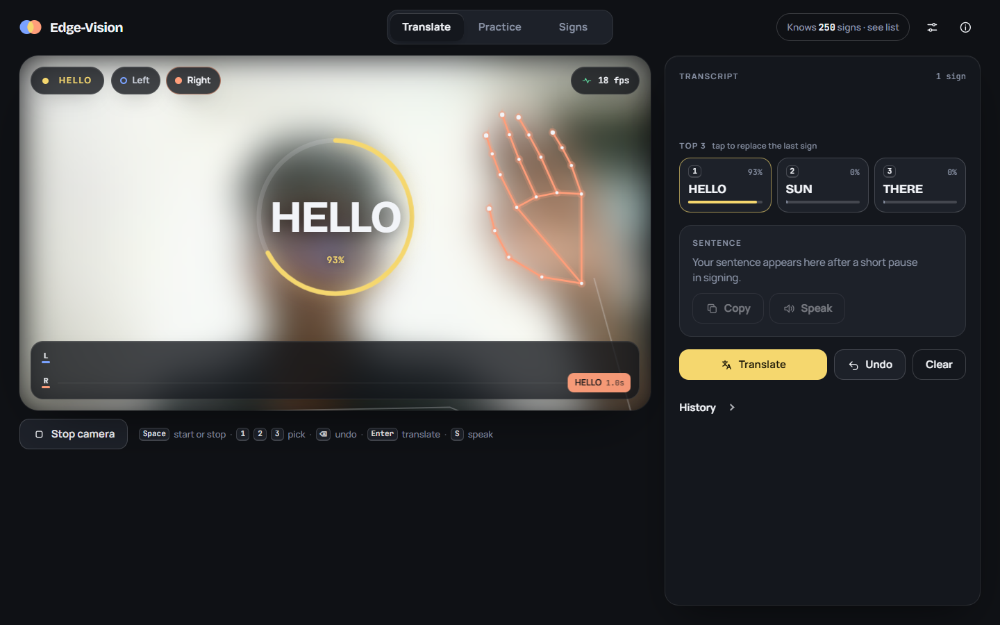

# ManuVox

(research codename: Edge-Vision)

**Your hands, spoken aloud.** ManuVox recognises 250 isolated American Sign Language (ASL) signs
from a webcam, entirely in the browser on a low-power laptop, and turns the recognised signs into
a simple spoken sentence. It is a research demo, not a full ASL translator: each sign is read on
its own, from a fixed vocabulary, and the grammar ASL carries in space, movement and the face is
not captured.

- **Live app:** <https://swapnil007-curious.github.io/manuvox/>
- **Paper:** coming soon ("ManuVox: Auditing the Train–Serve Gap of a Landmark-Based Sign
  Recognizer on a Laptop"; source and build instructions in [`paper/`](paper/README.md))
- **Author:** Swapnil Shukla
- **Licences:** code MIT ([`LICENSE`](LICENSE)); datasets in
  [`docs/DATA_LICENSES.md`](docs/DATA_LICENSES.md); third-party software and models in
  [`THIRD_PARTY.md`](THIRD_PARTY.md). Cite with [`CITATION.cff`](CITATION.cff).



## Results

v2 is the shipped model, trained on the Google ISLR (Kaggle `asl-signs`) landmarks only. v3 adds
ASL Citizen's training videos and webcam augmentation; ASL Citizen's licence allows research use
only, so v3 stays local and the public site serves v2. Every number below is written from the
result files by `scripts/readme_results.py`.

<!-- results:start (scripts/readme_results.py) -->
| Test set | n | v2 (public default) | v3 (research only) | v3 - v2 | Source |
|---|---|---|---|---|---|
| Google ISLR signer-independent test (4 unseen signers), top-1 | 16,242 | 68.4% [67.7, 69.1] | 69.4% [68.7, 70.1] | +1.0 pts, Holm p < 0.001 (significant) | `results/v2_vs_v3.md` |
| ASL Citizen official test (236 mapped signs, 11 unseen signers), top-1 ¹ | 3,523 | 43.1% [41.5, 44.8] | 92.1% [91.2, 93.0] | +49.0 pts, Holm p < 0.001 (significant) | `results/asl_citizen/` |
| Live webcam clips, browser (50 clips, one signer), clip top-1 ² | 50 | 34.0% [21.3, 46.7] | 44.7% [31.3, 57.3] | +10.7 pts, Holm p = 0.238 (not significant) | `results/v2_vs_v3.md` |
| Live webcam clips, Python + Holistic, clip top-1 | 50 | 40.0% [26.0, 54.0] | 46.0% [32.0, 60.0] | +6.0 pts, Holm p = 0.508 (not significant) | `results/v2_vs_v3.md` |

| Separate results | v2 | v3 | Source |
|---|---|---|---|
| Teach Dex, personalised (take-2 clips, model alone → up to 3 examples per sign, replays of take 1) ³ | 31% → 47% (+16 pts [5, 28], Holm p = 0.031, significant) | compromised run (see ³): 23% → 28% (+5 pts [0, 12], Holm p = 0.500, not significant) | `results/teach_dex.md`, `results/teach_dex_v3.md` |
| Classifier in Chrome on an i3-1115G4 (wasm, 1 thread), p50 / p95, file size | 14.3 / 21.2 ms, 6.9 MB | 13.3 / 31.3 ms, 6.9 MB | `results/perf/v2_vs_v3_classifier_latency.json` |

Each test set was evaluated once per model; the four top-1 comparisons are one Holm family (`scripts/compare_v3.py`). ¹ v3 trained on ASL Citizen's training signers, so its ASL Citizen score is in-domain and v2's is cross-dataset; the label mapping is AI-assisted and unconfirmed by a signer. ² Browser scores are means over 3 runs. ³ One signer, taught with take 1 and tested on take 2 of the same sitting; never pooled with the rows above. **The v3 Teach Dex run is compromised:** its model-alone score on take 2 (23%) is far below v3's own 39% on the same clips in the live-gap runs, and its classified segments per run fell (28, 23, 15, against 26, 29, 30 with v2; the harness logs no frame rate), so its gain says nothing about teaching v3 and the run needs repeating. v3 is trained on ASL Citizen (research licence) and is not deployed.
<!-- results:end -->

## How to run

- **Use it:** open the live app in Chrome or Edge on a laptop with a webcam, allow the camera and
  sign. Video never leaves the device; only the recognised words are sent if you ask for a
  sentence.
- **Run the app locally** (Node 20.19+), from `web/`: `npm ci`, `npm run fetch-assets`, then
  `npm run dev` (details in [Run locally](#run-locally)).
- **Python** (Python 3.11): [Setup](#setup) below, then the pipeline in
  [Preprocessing](#preprocessing), [Training](#training) and [Evaluation protocol](#evaluation-protocol).
- **Reproduce the paper's tables and figures:** [`paper/README.md`](paper/README.md).
- **v3 / ASL Citizen** (research licence, private Kaggle notebooks):
  [`kaggle/ASL_CITIZEN.md`](kaggle/ASL_CITIZEN.md).

### Naming

The project was renamed from Edge-Vision to ManuVox for v1.0.0. The Python package and module
stay `edgevision` (`pip install -e .`, `import edgevision`) to avoid a risky refactor, and so do
internal identifiers that users or saved data depend on: browser storage keys (`edge-vision.*`,
so settings and taught signs survive the move), the recordings file format, the private Kaggle
dataset `edge-vision-src`, and the translation Worker `edge-vision-translate`, whose URL is
unchanged.

## Technical documentation

The sections below document the research code: landmark preprocessing, signer-independent
splits and compact sequence classifiers (GRU, temporal CNN, transformer, convolution–transformer
hybrid) for the Kaggle [Google Isolated Sign Language Recognition](https://www.kaggle.com/competitions/asl-signs)
data (`asl-signs`), exported to ONNX and run in the browser.

## Setup

Python 3.11, from the repository root (Windows PowerShell shown). torch is the CPU build from the
PyTorch index, so it is installed first:

```powershell
python -m venv .venv
.venv\Scripts\Activate.ps1
pip install torch==2.15.0+cpu --index-url https://download.pytorch.org/whl/cpu
pip install -r requirements-dev.txt
pip install -e .
```

`requirements.txt` holds the package dependencies (preprocessing, plus py-cpuinfo for benchmark
records), `requirements-train.txt` adds torch, onnx and onnxruntime, and `requirements-dev.txt`
adds the test and lint tools.

## Preprocessing

```powershell
python scripts/preprocess.py --help
python scripts/preprocess.py --data-root <asl-signs dir> --output-dir <output dir>
```

Settings live in `experiments/preprocess_default.yaml`, whose paths point at Kaggle.
`--data-root`, `--output-dir` and `--limit` override the YAML. `--no-cache` skips the per-sequence
cache in `<output dir>/cache/`, which otherwise makes reruns resumable.

The run writes `features.npz`, `manifest.csv`, `preprocess_report.json` and
`splits_<mode>.json` to the output directory.

## Training

Each model has a config in `experiments/train_<model>.yaml` (`gru`, `cnn`, `transformer`). A short
local smoke run on CPU:

```powershell
python scripts/train.py --config experiments/train_gru.yaml --seed 0 --processed-dir <processed dir> --epochs 2 --device cpu
```

A run writes `config.yaml`, `metrics.csv`, `best.pt`, `label_map.json`, `summary.json` and the
split file it used to `results/runs/<experiment>/seed_<seed>/`. A v1 config's experiment is
`<model>_<split_mode>` (e.g. `gru_signer_independent`); v2 configs name theirs. It refuses to
replace a completed run unless `--overwrite` is passed. The processed directory is only read.

Full training runs on a Kaggle GPU; see [kaggle/TRAINING.md](kaggle/TRAINING.md) for the notebook
cells.

## Evaluation protocol

- **Signer-independent split.** Participants are assigned whole to train, validation or test (4
  test and 3 validation signers), so test signers are never seen in training. A signer-dependent
  stratified split is trained only as a comparison.
- **Model selection on validation only.** Checkpoints, early stopping and the choice of best model
  use validation top-1. `scripts/aggregate_val.py` summarises validation metrics from the runs'
  summaries and never reads the test split.
- **One test evaluation script.** `scripts/final_eval.py` is the only code that loads the test
  split, for the checkpoints and (with `--quant-root`) their quantised variants, and it logs
  every invocation to `results/final/test_access_log.json`.
- **Seeds.** Each signer-independent configuration is trained with seeds 0, 1 and 2, and results
  are reported as the mean and standard deviation over seeds. Runs are seeded and use
  deterministic algorithms where available; GPU runs may still differ bitwise between repeats.
- **Seed ensembles.** For every experiment with at least two completed seeds, `aggregate_val.py`
  also scores the mean of the seeds' logits on validation (`val_ensemble.csv`) and
  `final_eval.py` on test (`test_ensemble.csv`).
- **Experiments.** Every table starts with an `experiment` column. Runs are found from their
  `summary.json` fields (model, split mode, feature set, recipe); summaries written before these
  fields existed are v1 runs.

## v2 ablation: features, recipe and architecture

The v2 grid changes one thing at a time against the v1 CNN (`cnn_signer_independent`), with the
same signer-independent split:

| Experiment | Model | Features | Recipe |
| --- | --- | --- | --- |
| `b_cnn_v2feat_v1recipe` | cnn | v2 | v1 |
| `c_cnn_v2feat_v2recipe` | cnn | v2 | v2 |
| `d_hybrid_v2feat_v2recipe` | hybrid | v2 | v2 |

- **v2 landmarks** (`experiments/preprocess_v2.yaml`): pose 0-16 (nose, eyes, ears, mouth
  corners, shoulders, elbows, wrists), so L = 59. Mirroring swaps every selected left/right pose
  pair. `preprocess_report.json` records the selection (`landmarks`) and, for v1 and v2 alike, the
  face/shoulder `aspect_stats`.
- **v2 features** (`models/features_v2.py`, inside the ONNX graph): coordinates, velocity,
  acceleration, the 210 pairwise distances of the dominant hand and 24 distances from its wrist
  and fingertips to the nose, mouth centre and shoulders; 588 features, standardised with train
  statistics. Any value derived from a missing point is 0.0.
- **v2 recipe**: 150 epochs, patience 30, an exponential moving average of the weights (decay
  0.999; validation and `best.pt` use it), and extra augmentations: frame dropout, time masking,
  landmark masking and hand-shape rotation.
- **Hybrid** (`models/hybrid.py`): three stages of two depthwise-conv blocks and one transformer
  block, with late head dropout (off for the first half of the epochs).

```powershell
python scripts/preprocess.py --config experiments/preprocess_v2.yaml --data-root <asl-signs dir> --output-dir <processed_v2 dir>
python scripts/run_grid.py --grid v2 --processed-dir <processed_v2 dir> --max-hours 10
```

`--max-hours` stops starting new runs once that much wall time has passed; a rerun resumes.
Quantisation handles v1-feature runs only; `scripts/export_web.py` also exports v2 runs (as fp32,
since they have no quantised variants) and, with `--ensemble`, the seed ensemble of a run's
experiment.
`src/edgevision/export/ensemble.py` exports the seeds of one experiment as one ONNX file that
averages their logits.

## v3: ASL Citizen cross-dataset evaluation and training

[ASL Citizen](https://www.microsoft.com/en-us/research/project/asl-citizen/) is webcam recordings
of 2,731 ASL signs by 52 signers, with official signer-independent splits. It is licensed for
non-commercial research only and may not be redistributed. Its data and landmarks never enter
this repository, its notebooks and dataset stay private on Kaggle, and the v3 model is kept off
the public site (docs/DATA_LICENSES.md).

- **Label mapping** (`src/edgevision/data/citizen_labels.py`): 236 of the 250 signs map, 171 of
  them exactly, 35 through numbered variants and 30 through synonyms. The variant and synonym
  choices come from ASL-LEX 2.0's translations; they are AI-assisted and unconfirmed. 14 signs
  have no mapping, three of them (can, fall, glasswindow) awaiting a decision between senses.
- **Extraction** (`kaggle/asl_citizen_smoke.ipynb`, `asl_citizen_part{1,2,3}.ipynb` and
  `asl_citizen_merge.ipynb`, built by `scripts/build_kaggle_notebooks.py`): range requests fetch
  only the needed videos from the 46 GB archive, and MediaPipe Holistic 0.10.21 runs with the
  training settings in a uv Python 3.11 venv. Shards are resumable and split over three parallel
  parts. Every notebook takes the code from the private dataset `edge-vision-src`, a checked
  git archive, never from a clone.
- **Cross-dataset test** (`scripts/citizen_eval.py`): the official test split is evaluated once
  per model and logged in `results/asl_citizen/test_access_log.json`.
- **v3 training** (`kaggle/train_v3.ipynb`, `experiments/train_e_hybrid_v3citizen.yaml`): the v2
  hybrid on asl-signs train plus ASL Citizen train, with webcam augmentation (aspect, frame rate,
  dropped hand frames). The epoch is selected by the mean of the asl-signs and ASL Citizen val
  top-1, the seed on validation, and the export is fp16 with calibration from validation.
- **v2 vs v3** (`scripts/compare_v3.py`): the asl-signs test split, the ASL Citizen test split
  and test_clips_v2, side by side, with paired tests and a Holm correction.

Run instructions: kaggle/ASL_CITIZEN.md.

## Quantisation

Post-training quantisation with ONNX Runtime, for every completed signer-independent run:

```powershell
python scripts/quantize.py --runs-root results/runs --processed-dir data/processed
python scripts/final_eval.py --processed-dir data/processed --quant-root results/quant
```

`quantize.py` writes five variants per run to `results/quant/<model>_signer_independent/seed_<s>/`:

- `fp32.onnx`: the checkpoint exported at opset 17, velocity and standardisation included.
- `fp16.onnx`: float16 weights and compute with float32 input and output. If any val output is
  non-finite or val top-1 agreement with fp32 is below 99%, it is rebuilt with the feature block
  (velocity and standardisation) kept in float32, and the report says so.
- `int8_dynamic.onnx`: dynamic quantisation, int8 weights per channel.
- `int8_static.onnx`: static QDQ quantisation after `quant_pre_process`, uint8 activations and
  int8 per-channel weights, MinMax calibration on 1024 train sequences sampled with seed 0 and
  fed in batches of 64. Calibration reads only the train split. The feature block's nodes are
  excluded from quantisation, so the `landmarks` input, velocity and standardisation stay
  float32 and quantisation starts at the input of the first projection layer. Quantising the
  raw input would round coordinates to an 8-bit grid before velocity is computed, and could turn
  small coordinates (common near the torso centre after shoulder normalisation) into exact
  zeros, which the feature block treats as missing points. The build fails if no feature-block
  node is found, or if any QuantizeLinear node still reads the input or a tensor inside the block.
- `int8_static_full.onnx`: an ablation only, the same as `int8_static` (same calibration data
  and settings) but with nothing excluded, so the input and feature block are quantised too.
  It is evaluated and benchmarked like the other variants.

Each run's `quant_report.json` records, per variant, the file size, op counts, which MatMul, Gemm,
Conv and GRU nodes stayed float, the checker and onnxruntime load results, val top-1, val top-1
agreement with fp32 and the largest logit difference from fp32 on 512 val sequences. It also
records `excluded_node_count` and `excluded_node_names` (the nodes passed to the quantiser's
`nodes_to_exclude`, empty for every variant except `int8_static`) and `input_quantised`, whether a
QuantizeLinear or DynamicQuantizeLinear node reads `landmarks`. A variant that fails is recorded
there and the other variants still run. `results/tables/quant_ops_summary.csv` summarises the
reports. Existing variant files are reused unless `--overwrite` is passed; a file built from a
different `best.pt` is reported as stale. Each file records the schema version of its variant's
build recipe, and a file from an older version is rebuilt without `--overwrite`: `int8_static`
files built before the feature-block exclusion are replaced this way, while the other variants'
files are kept.

`final_eval.py --quant-root` evaluates every variant on test, first checking that each fp32
variant's test top-1 matches its checkpoint's within 0.1 percentage points. It writes
`results/final/quant/<model>/seed_<s>/<variant>_test_metrics.json` and
`results/tables/test_quant_summary.csv`, where deltas against fp32 are paired by seed. Without
`--quant-root` the script behaves as before. The `.onnx` files are not tracked by git; the reports
and tables are.

## Benchmarking

```powershell
python scripts/benchmark.py
```

The benchmark measures CPU latency for one sequence per call. Defaults: models `gru`, `cnn` and
`transformer` at seed 0, variants `torch_fp32`, `onnx_fp32`, `fp16`, `int8_dynamic`,
`int8_static` and `int8_static_full` (the ablation), and 1, 2 and 4 intra-op threads. `--batch N`
switches to a throughput mode whose output files carry a `_batch<N>` suffix.

Measurement protocol:

- **Inputs.** Val sequences in split order, cycled. The test split is never read.
- **Sessions.** Each configuration gets a fresh session: onnxruntime with `ORT_SEQUENTIAL`, one
  inter-op thread and `ORT_ENABLE_ALL`, or eager torch under `torch.inference_mode` with
  `torch.set_num_threads`. Session creation time and the approximate growth in process RSS are
  recorded.
- **Timing.** 100 warm-up calls, then 2000 calls each timed on its own with `time.perf_counter_ns`,
  with Python's garbage collector paused. The run reports mean, p50, p95, p99, min and max in ms,
  and throughput in sequences per second.
- **Rounds.** The full configuration list runs 3 times, in a new seeded random order each round,
  with a 3 s pause between configurations. The summary reports medians across rounds, plus
  `p50_spread_ms`, the largest minus the smallest p50. With the defaults, the pauses alone take
  about 8 minutes.
- **Machine state.** Run on AC power, with the Windows power mode set to Best performance and
  other applications closed. `results/bench/bench_env.json` records the CPU flags detected at
  runtime (AVX2, AVX-512, VNNI), the clock at the start and end, the power source, the active
  power scheme and power mode, and the library versions. A run on battery prints a warning and
  records it there.

Outputs: `results/bench/bench_raw.csv` (one row per configuration and round),
`results/bench/bench_env.json` and `results/tables/bench_summary.csv`. The summary's
`p95_share_of_33ms_frame` column is p95 latency as a share of one 30 fps frame.

## Web demo

Live: <https://swapnil007-curious.github.io/manuvox/>

`web/` is an installable, offline-capable sign-to-speech app (Vite and strict TypeScript, no UI
framework). MediaPipe Tasks HandLandmarker (two hands) and PoseLandmarker lite produce landmarks
for each frame in a Web Worker; a TypeScript port of the Python live pipeline
(`web/src/livePipeline.ts`, `live.ts`, `preprocess.ts`) maps them to the Holistic layout the
model was trained on and cuts the stream into signs; onnxruntime-web runs the classifier in a
second worker. `web/src/engine.ts` holds that pipeline; the interface (`web/src/main.ts`,
`web/src/ui/`) only listens to its events. The shipped model is the v2 hybrid (fp16), chosen in
`results/model_selection.md`; the live-gap evaluation on recorded webcam clips is in
`results/live_gap.md`.

- **Scope.** Recognises 250 isolated ASL signs (the asl-signs labels) and builds simple sentences
  from them. It is not a full ASL translator: grammar carried by facial expression, space and
  movement is not captured, and every sign is read on its own.
- **Privacy.** Video never leaves the device; only recognised words are sent for sentence
  translation. A Content-Security-Policy restricts every request to the app's own origin plus the
  translation Worker's origin, a service worker serves the app, the model and the MediaPipe files
  from the device after the first load, and there is no analytics or telemetry. Sentences are
  spoken with on-device voices only.

### The interface ("Duet")

Two hands, two colours, one voice: the signer's left hand is periwinkle (#7AA2FF) and the right
hand peach (#FF9E7A) everywhere (skeleton, fingertip trails, the hand chips, the timeline lanes);
accent gold marks confirmed words and the primary action. Display type is Bricolage Grotesque, the
interface Manrope, numbers JetBrains Mono (self-hosted Latin subsets from @fontsource).

- **Translate.** The camera fills a 16:9 stage (full screen on phones) with a glass HUD: a status
  pill driven by the segmenter (Ready, Signing with a pulsing ring, Reading with a spinner, then
  the word), the hand chips, hints ("Too dark", "Hands partly out of frame", a gentle "Raise your
  hands" after 10 s without one) and a two-lane timeline with one chip per sign, in the lane of
  the hand that signed it and sized by its duration. A recognised word rises into the centre in
  its confidence ring (the arc fills to the calibrated confidence) and flies into the transcript.
  Below the confidence threshold a "Not sure" picker shows the top 3 and nothing is added until
  one is picked. Candidates 1-3 also replace the last word; Backspace undoes. After 2 s without
  signing (a setting) the glosses are translated into a sentence, which is shown, can be copied
  and is spoken (auto-speak on by default; voice and rate in Settings), and kept in a history.
- **Practice.** A target sign with its description: Go, a 3-2-1 countdown, then the next sign is
  scored correct (top guess, a small burst and XP with a streak bonus), close (in the top 3) or
  try again (with what the model saw). Streaks, accuracy per sign and "your hardest signs" are
  kept in localStorage.
- **Signs.** All 250 signs, searchable, each with a short reminder of the handshape and motion,
  a link to a dictionary video on SignASL.org (no video is copied) and "Practise". The top bar's
  "Knows 250 signs · see list" chip opens it from anywhere.
- **Diagnostics** (the fps chip on the stage): tracking fps, model latency, hands detected,
  lighting, the classifier backend, MediaPipe delegate, aspect correction, the 60-second benchmark
  and Record test signs.
- **First run.** A three-step overlay: why the camera is needed (before the browser's own
  prompt), framing yourself (a dotted upper-body outline that turns green), then trying "hello".
  Camera blocked, no camera, camera busy, loading (a byte-level progress bar), unsupported
  browser and errors each have their own state on the stage.
- **Keyboard.** Space starts or stops the camera, 1/2/3 pick a candidate, Backspace undoes,
  Enter translates, S speaks. Focus is always visible, recognised words and sentences are
  announced through an aria-live region, targets are at least 44 px.
- **Motion.** Springs (damping ratio 1.0, interruptible, velocity-carrying, transform and opacity
  only) for movement, with the one bounce kept for the word landing; the mobile bottom sheet
  follows the finger with momentum projection between its two detents. With
  prefers-reduced-motion everything fades instead and the fingertip trails are off;
  prefers-reduced-transparency makes the glass opaque. While the camera runs, glass over the video
  is not blurred: re-blurring a moving video every frame took GPU time MediaPipe needs (tracking
  fell to about 8 fps on the target laptop with blur).
- **Contrast.** `npm run contrast` checks every text / background pair of both themes for WCAG AA
  from the colour tokens in `src/styles.css`; text on glass over the video is checked against the
  surface composited over both a black and a white frame.

### Run locally

Node 20.19 or newer, from `web/`:

```powershell
npm ci
npm run fetch-assets   # MediaPipe wasm and .task models into public/mediapipe/ (not in git)
npm run dev            # development server
npm run build          # production build into dist/
npm run preview        # serves dist/ at http://localhost:4173/
```

`site.config.json` holds the translation Worker's URL (empty: sentences are joined on the
device and marked "basic"); `VITE_WORKER_URL` overrides it for a build. Camera access needs a
secure context; `localhost` qualifies. `npm run fetch-assets` checks every
file against a pinned or npm-provided sha256, writes `public/mediapipe/ASSETS.json` (URL, sha256,
size, licence) and skips files that are already present.

Tests: `npx tsc --noEmit`, `npm run contrast`, `npx vitest run` (the live-pipeline parity test
on 20 val sequences, preprocessing and aspect correction against the Python golden vectors, the
offline sentence joiner, the translation client and its fallbacks, the transcript's
replace/undo rules, practice scoring, preferences and history with blocked storage, the colour
contrast and the Worker vocabulary staying in sync) and, after `npm run build`,
`npx playwright install chromium` then `npx playwright test` (model and preprocessing parity in
Chromium, offline reload through the service worker, a camera smoke test, the interface flow
driven through the debug hook, Record test signs, and a recorded clip end to end when
`data/live_clips/hello.y4m` exists). For a build under another base path, set `BASE_PATH` (for
example `/manuvox/`) for both the build and the tests. Node 22.18 or newer runs the contrast
script (it imports TypeScript directly).

Screenshots: `docs/screenshots/` (`npm run screenshots`; the header of
`web/scripts/screenshots.mjs` says which states are captured live from a recorded clip and which
are staged through the debug hook). The camera video is blurred in every screenshot for the
signer's privacy; the hand skeleton and the interface are captured as rendered.

### Features spec: one source of truth

`features_spec.json` at the repository root holds every landmark constant: the selected
landmarks and their order (both hands, then the pose set; no face or lip points), the pose
points by name and the left/right pairs mirroring swaps, missing-point handling (NaN raw, a hand
present only when all 21 points are finite, 0.0 after resampling), the dominant-hand flip, the
shoulder normalisation and its fallback, the 32-frame resampling (by kept-frame index in
training, on the kept-frame clock live), z dropped, the model input layout, the aspect constants
and the live segmenter's thresholds. `src/edgevision/spec.py` reads it for training, export and
the offline pipeline and `web/src/spec.ts` imports it into the app bundle; neither defines those
constants itself. `scripts/calibrate_live.py` derives the data-dependent values (the training
aspect and the segmenter thresholds) from the train and val splits only.

Parity is tested end to end. `scripts/export_live_golden.py` writes
`web/tests/golden/live_parity.json`: 20 val sequences as raw landmarks (dataset rows and
MediaPipe Tasks-style frames with handedness labels), the Python pipeline's model inputs and the
exported model's logits, plus a stream of four sequences for motion energy and segmentation.
`web/tests/unit/liveParity.test.ts` runs the web pipeline and onnxruntime on the same raw
landmarks and fails unless every model input matches within 1e-4 and the top-1 is the same;
`tests/test_live_parity.py` checks that the fixture still matches Python, the committed model and
the spec.

### Live pipeline

Each frame, in order (`src/edgevision/live/pipeline.py` is the reference, `web/src/livePipeline.ts`
the port):

1. **Tracker mapping.** MediaPipe Tasks landmarks are mapped to Holistic's layout. Holistic's
   `left_hand` is the hand it crops at pose landmark 15 (the signer's left wrist), so a detected
   hand goes to the block of the nearer pose wrist, and two hands take the pairing with the
   smaller total distance; without a pose, Tasks' handedness label decides. z is dropped, as in
   training, so the different z scales of the two trackers never reach the model.
2. **Mirroring.** The landmarkers get the unmirrored camera frame; only the preview is drawn
   mirrored. Left-handed signing is flipped to the trained side by preprocessing's own rule (the
   left hand present in more kept frames than the right).
3. **Aspect.** Coordinates are fractions of the frame's width and height, and the training videos
   are portrait phone recordings. Every y is scaled about the frame's shoulder midpoint by
   k = train_width_over_height / (width / height), from the real size of the frame given to the
   landmarkers; train_width_over_height (0.723) comes from the face proportions of the training
   data. The body-ratio calibration below is kept as an alternative.
4. **Motion energy.** The speed of the wrist and fingertips over 100 ms, in shoulder widths per
   second, on the aspect-corrected points.
5. **Segmentation.** IDLE -> SIGNING when a hand is present and its energy reaches
   `start_energy`; SIGNING ends when the hands are gone for 200 ms, stay below `still_energy` for
   400 ms, or after 3 s. The thresholds are percentiles of the val split's energies
   (`calibrate_live.py`). While signing, an early guess is shown every 500 ms after the first
   600 ms; the model runs once on the finished segment.
6. **Resampling by time.** Every frame carries its capture time (`requestVideoFrameCallback`'s
   `captureTime`), and the 32 model frames are placed on the kept-frame clock (each kept frame
   advances it by its own capture interval, capped at 200 ms) instead of the kept-frame index.
   At a constant frame rate this is training's rule exactly; at 8-30 fps, or with dropped frames,
   the sign keeps its timing (`tests/test_live_resampling.py`).
7. **Decision.** softmax(logits / T) with the temperature T fitted on val (NLL), and a
   confidence threshold chosen on val to maximise coverage x (2 x selective accuracy - 1), i.e.
   accuracy traded against coverage, where an accepted wrong sign costs as much as an accepted
   right one gains. Both are stored in `meta.json` (`calibration`). Below the threshold the
   result reads "Not sure".

### Capture

The default automatic mode uses the motion segmenter above. Settings > Advanced also offers the
first demo's presence rule (a segment starts after 3 consecutive frames with a hand and ends after
8 frames without one, or after 3.0 s) and "hold to record", which shows a button under the stage
to press and hold while signing. Segments with fewer hand frames than the model's
`min_hand_frames` are discarded. The pose selection and the left/right pose pairs that mirroring
swaps come from `meta.json`, so the same app runs v1 (7 pose points) and v2 (pose 0-16) models.
MediaPipe runs on the GPU delegate by default and falls back to the CPU if the GPU fails (at
creation or while detecting) or is too slow; Diagnostics shows which is in use and why. The hand
landmarker runs on every frame and the pose landmarker on every Nth frame (1 to 3, default 2);
pose points for the frames in between are interpolated linearly in time.

### Aspect calibration (alternative mode)

The default aspect mode ("From the camera's frame size") uses the frame's width and height as described
above. The calibrated mode, the first demo's default, measures the body instead. The ratio
r = |y_nose - y_shoulder_mid| / |x_shoulder_left - x_shoulder_right| measures it;
`meta.json` carries the training median r_train from `preprocess_report.json`'s `aspect_stats`.
For 2 seconds after the camera starts (and on "Recalibrate"), the app takes the median r_live
over frames where the nose and both shoulders are inside the frame with visibility >= 0.5, and
sets k = r_train / r_live, clamped to [0.25, 4]. Before preprocessing, every landmark's y becomes
y_mid + (y - y_mid) * k, with y_mid the frame's shoulder-midpoint y (0.5 without both shoulders);
x is unchanged. Without visible shoulders the app asks the signer to move back and keeps k = 1.
Settings offer From the camera's frame size (default), Calibrated, Manual (a slider) and Off; the
Performance panel shows k and r_live. `src/edgevision/live/aspect.py` implements the same functions, and the web tests compare
them value for value.

### Record test signs and offline diagnosis

The "Record test signs" panel keeps, for every completed segment (classified, excluded or
discarded), the raw landmarks of each frame (hands after assignment and the 33 pose points, in
unmirrored normalised coordinates, before the aspect correction), frame times, pose visibility,
the camera resolution, framing, calibration and the app's features, model input and top-5, with
the sign chosen from a searchable list of the model's labels. No video or images are stored, and
recordings stay in memory until "Download recordings" saves them as one JSON file. Keep such
files under `data/live/`, which git ignores, then run:

```powershell
python scripts/live_diagnose.py --recordings data/live/<file>.json --meta web/public/model/meta.json --model web/public/model/model.onnx --processed-dir data/processed
```

It replays each recording through Python preprocessing and checks the app's features against it
(max |diff| <= 1e-4, exit code 1 otherwise), then evaluates top-1 and top-5 with no aspect
correction, with the app's recorded k, and with k = r_train / r_live computed offline per
recording session. It reports the predicted-label distribution, normalisation methods, shoulder
visibility, hand presence, segment lengths against the training lengths, r_live against
`aspect_stats`, and the standardised mean shift of each feature group against the model's own
FeatureBlock statistics, in `results/live/diagnosis_<timestamp>.json` and `.md`.

### Live-gap evaluation on recorded clips

The gap between dataset accuracy and the live demo is measured on webcam clips (file name = sign)
kept in `test_clips/`, which git ignores. Both pipelines see the same pixels: the offline Python
pipeline with legacy MediaPipe Holistic (the tracker asl-signs was built with), and the web app
in Chromium with the clip as its fake camera. Each config of `experiments/live_gap.json` changes
one setting, cumulatively from the shipped demo to the final pipeline, plus leave-one-out rows
that undo one fix at a time. Nothing is tuned on the clips: the constants come from
`features_spec.json` and `meta.json`, which are derived from the train and val splits.

```powershell
.venv-live\Scripts\python scripts/prepare_live_clips.py --clips test_clips --out data/live_clips  # requirements-live.txt
.venv-live\Scripts\python scripts/extract_holistic.py --clips data/live_clips
python scripts/live_gap.py python                                   # results/live_gap/python/
cd web; npm run build; npm run preview                              # another shell
node scripts/live-gap.mjs --channel chrome --delegate GPU           # results/live_gap/web/
cd ..; python scripts/live_gap.py report                            # results/live_gap.csv, .md
```

`prepare_live_clips.py` handles clips that are screen recordings of the demo page: it finds the
camera preview, removes the drawn landmark overlay by inpainting, flips the preview back to the
unmirrored camera view and writes 640 x 480, 30 fps `.y4m` files. The `c0_head_build` config runs
the demo as committed in 3fbafa3 (built with `experiments/head_build_hook.patch`, which only
records each segment's softmax) from a second preview server on port 4190.

### Exporting a model

`scripts/export_web.py` copies one ONNX variant to `web/public/model/model.onnx` and writes
`web/public/model/meta.json` (labels, feature set, input layout, landmark order, preprocessing
settings with the pose swap pairs, the training aspect statistics, sha256 of the ONNX file and of
each `best.pt`, opset, every variant candidate and the confidence threshold), plus the golden
vectors in `web/tests/golden/`:

```powershell
python scripts/export_web.py --run results/runs/cnn_signer_independent/seed_0 --processed-dir data/processed --verify-wasm
```

- **Variant rule.** Among fp32, fp16, int8_dynamic and int8_static, the smallest file whose val
  top-1 is within 0.5 percentage points of fp32 val top-1. For a run with a `quant_report.json`
  the candidates are its variants; otherwise (v2 runs, ensembles) they are built into
  `--work-dir`. Every candidate, with its size, val top-1 and why it was or was not eligible, is
  printed and stored in `meta.json`; `--variant <name>` overrides the rule and is recorded as
  forced.
- **onnxruntime-web check.** With `--verify-wasm` each exported file is built into the app and
  run through the Playwright model-parity test; if onnxruntime-web cannot run it, the next
  eligible variant is exported instead and the failure is recorded under `fallbacks`.
- **Seed ensemble.** `--ensemble` exports every seed of the run's experiment that has a `best.pt`
  as one ONNX file averaging their logits (`src/edgevision/export/ensemble.py`), and applies the
  same rule to its fp32, fp16 and int8_dynamic builds (int8_static finds the FeatureBlock by a
  node scope that ensemble members do not have, so it is not built).
- **Aspect statistics.** Taken from the processed dir's `preprocess_report.json`. A report written
  before `aspect_stats` existed can borrow them with `--aspect-report <report>` from another
  preprocessing run of the same raw data; the export checks that counts, kept sequences, split
  settings and the kept-frame rule match and that both selections hold the nose and shoulders.
- **Confidence threshold.** Computed on val only, from the exported variant's softmax: the
  smallest threshold t at which top-1 accuracy among val sequences with max probability >= t
  reaches `--target-precision` (default 0.80). If no t reaches it, the t with the highest
  accuracy among those accepting at least 20% of val is used and `meta.json` records a warning.
  Coverage, accuracy above t and overall val top-1 are stored with it. The test split is never
  read. The app uses this threshold only with the uncalibrated ("raw") decision setting.
- **Calibration.** Also on val only: a temperature T fitted by minimising the NLL of
  softmax(logits / T), then the threshold on the scaled probabilities that maximises
  coverage x (2 x selective accuracy - 1). `meta.json`'s `calibration` block stores T, the
  threshold, NLL and ECE before and after, coverage, selective accuracy and val top-1 / top-3;
  the app's default decision uses it.
- **Golden vectors.** `preprocess_cases.json` (v1 selection) and `preprocess_cases_v2.json`
  (pose 0-16) hold synthetic sequences built with the test suite's fixture builders (mirroring,
  ties, hand fallback, gaps, short and long sequences and both exclusion reasons) with the Python
  outputs; `aspect_cases.json` holds calibration, visibility and per-frame correction cases with
  the preprocessing that follows; `recording_example.json` is a recordings file in the download
  schema; `model_cases.json` holds 16 processed val inputs and the logits Python onnxruntime gives
  for them. The Python tests check that the committed files still match Python and the committed
  model.
- `--data-source synthetic` marks fixture data in `meta.json`; the app then shows a banner that
  the model does not recognise real signs. `meta.json` always states which data the committed
  model came from.
- Commit `model.onnx` only while it is under 10 MB; `.gitignore` admits only that one ONNX file.

### Teach Dex (personalisation)

The Teach tab lets a signer teach Dex their own version of a sign. They pick the sign and record
three examples (a 3-2-1 countdown each, then the segmenter catches the sign). The app keeps the
model's penultimate embedding of each example. It is a second ONNX output, `embedding`, 256
values; the re-export left the logits bit-identical.

- **Storage:** the embeddings are kept in IndexedDB on the device and are never uploaded.
  Where IndexedDB is blocked they are kept for the session only, and the panel says so.
  Examples recorded with another model are ignored.
- **At recognition:** each taught sign's logit becomes logits / T + weight × (s − offset), where
  s is the highest cosine similarity to the user's examples of that sign. Untaught signs and the
  "not sure" threshold are unchanged.
- **Calibration:** weight and offset are fitted on the validation split by simulating three
  examples per sign for one val signer at a time (`scripts/calibrate_teach.py`, meta.json
  `personalization`).
- **Badge:** a prediction the examples changed carries "Personalized for you".
- **Controls:** the panel has an on/off switch and Reset my signs.

The evaluation is separate from every main result. `web/tests/e2e/teach-eval.spec.ts` teaches
each sign from take 1 of test_clips_v2 through the real panel, then tests take 2 (`TEACH_EVAL=1`,
three runs). It drives the installed Chrome with the GPU tracker, as the live-gap runs do. Each
take-1 clip gets a short still lead-in, so the countdown does not cover the recorded sign. `scripts/teach_report.py` writes `results/teach_dex.md`.

### Sentence translation

The transcript holds glosses (HELLO MOM DRINK WATER). Translate (or 2 s without signing) sends
them to a small Cloudflare Worker in `deploy/worker/` (the same pattern as Veridex's proxy), which
asks Groq's OpenAI-compatible API for one sentence with a fixed prompt: "Turn this ASL gloss
sequence into one short, natural English sentence; do not add facts that the glosses don't
support; return only the sentence." It accepts only glosses from the app's vocabulary
(`deploy/worker/src/vocabulary.json`, generated by `npm run vocabulary` and checked by a web unit
test), at most 24 per request, and asks for at most 120 output tokens. Rate limits per client
address live in a Durable Object: 30 requests per 10 minutes and 300 per day, plus a global cap of
3000 a day. The API key is the `LLM_API_KEY` secret; glosses and sentences are not stored or
logged. CORS allows `ALLOWED_ORIGINS` (the Pages site) and localhost.

When the Worker is not configured, offline, slow (6 s), rate-limited or failing, the app joins the
glosses on the device instead (lower-cased, compound glosses split such as THANKYOU -> "thank
you", the first word capitalised, a comma after a leading greeting, a question mark after a
question word) and marks the sentence "(basic)".

Deploying (from `deploy/worker/`, with a Cloudflare account and a Groq API key):

```powershell
npm ci
npx wrangler login
npx wrangler secret put LLM_API_KEY      # paste the Groq key when asked
npx wrangler deploy                      # prints https://edge-vision-translate.<account>.workers.dev
npx vitest run                           # tests in workerd, upstream mocked
```

Then give the Pages build the URL, either as the repository variable
(`gh variable set WORKER_URL --body "https://edge-vision-translate.<account>.workers.dev"`, or
Settings -> Secrets and variables -> Actions -> Variables) or in `web/site.config.json`.

### Performance

- **Workers.** `web/src/inference.worker.ts` runs in two instances: one holds the landmarkers and
  gets every frame as a transferred `ImageBitmap`, the other holds the onnxruntime-web session,
  so classifying a segment never stalls tracking. Frames are captured with
  `requestVideoFrameCallback`; while a detection runs, only the newest frame is kept and it goes
  to the worker the moment the detection finishes.
- **MediaPipe** runs on the GPU delegate (WebGL in the worker) and falls back to the CPU when the
  GPU fails, or when two frames after warm-up take over 250 ms each: with software-rendered
  WebGL (a blocklisted GPU, headless Chromium) the GPU delegate took ~1.3 s per frame against
  ~90 ms on the CPU.
- **onnxruntime-web** uses the wasm backend with SIMD. Wasm threads need cross-origin isolation:
  the dev and preview servers send COOP/COEP, and on GitHub Pages the service worker adds them to
  every response it serves (coi-serviceworker style), reloading the first visit once when it
  takes over. On the target laptop threads only slowed this model down, so the default is one
  thread (Settings can raise it). "Auto" also tries WebGPU and keeps it only if it is faster than
  wasm and its logits agree; otherwise, or on any WebGPU error, it falls back to wasm.

Measured on the target laptop (i3-1115G4, 4 logical cores, Intel UHD, 20 GB, Chrome 157), with a
recorded clip as the fake camera and the app's 60-second benchmark:

```powershell
npm run build; npm run preview            # in web/, another shell
node scripts/benchmark-tracking.mjs       # results/perf/tracking_gpu.json (--delegate CPU, --threads N, --hud off)
node scripts/benchmark.mjs                # classifier alone: wasm x1/2/4 and WebGPU
```

| Configuration | Tracking fps | Hand landmarker p50 / p95 | Classifier per segment p50 / p95 |
| --- | --- | --- | --- |
| GPU delegate, classifier wasm x1 (default) | 24.1 | 30.6 / 43.0 ms | 18.6 / 27.2 ms |
| GPU delegate, classifier wasm x2 | 24.3 | 30.2 / 43.1 ms | 19.9 / 45.1 ms |
| GPU delegate, classifier wasm x3 | 22.5 | 33.3 / 46.4 ms | 40.4 / 81.5 ms |
| CPU delegate (fallback), wasm x1 | 9.8 | 85.2 / 127.6 ms | 20.6 / 22.0 ms |

The default meets the targets of at least 15 fps tracking and under 60 ms of model time per
segment; the CPU fallback does not reach 15 fps. The first demo (main thread, before these
changes) ran at 5-13 fps on the same clips. These rows were measured with the interface before
the Duet redesign.

With the Duet interface, the HUD on and off and the previous interface were measured back to back
in one later session (the same laptop on AC power, but charging from 13% and running warmer, so
compare rows within this table rather than with the one above):

```powershell
node scripts/benchmark-tracking.mjs --out ../results/perf/tracking_duet_gpu.json              # HUD on
node scripts/benchmark-tracking.mjs --hud off --out ../results/perf/tracking_duet_gpu_nohud.json
```

| Interface | Tracking fps | Hand landmarker p50 / p95 | Classifier per segment p50 / p95 |
| --- | --- | --- | --- |
| Duet, hand skeleton (HUD) on (default) | 19.0 | 39.7 / 61.1 ms | 27.7 / 76.0 ms |
| Duet, HUD off | 20.4 | 38.0 / 54.9 ms | 26.0 / 32.4 ms |
| Previous interface (same session) | 21.5 | 36.7 / 51.1 ms | 21.7 / 26.5 ms |

Drawing the HUD costs about 1.4 fps; the new interface as a whole about 2.5 fps against the
previous one. Its first version used backdrop-filter blur on the glass over the running video,
which dropped tracking to about 8 fps on this GPU, so the glass over the video is unblurred while
the camera runs. The classifier's p95 with the HUD on comes from one slow call among 13 segments
(p50 27.7 ms).

The final Duet build was measured again on an idle laptop on AC power, two runs per setting in
alternating order (on, off, off, on), in the installed Chrome
(`results/perf/tracking_duet_final_gpu*.json`):

| Duet, final build | Tracking fps (runs) | Hand landmarker p50 / p95 | Classifier per segment p50 / p95 |
| --- | --- | --- | --- |
| HUD on (default) | 25.2 (25.6, 24.8) | 28.6 / 39.7, 28.3 / 43.2 ms | 16.5 / 21.6, 17.0 / 37.6 ms |
| HUD off | 24.8 (23.0, 26.5) | 27.6 / 51.0, 26.3 / 39.8 ms | 19.6 / 106.0, 16.0 / 48.0 ms |

The second run of each pair was the slower one, so the order of the runs (the laptop warming up)
moved tracking by more than the HUD did; drawing the HUD has no cost that two runs can resolve. Every
run stays well above 15 fps. With 13 to 16 segments per run, the classifier's p95 is close to its
slowest call: it was under 60 ms in three of the four runs, and one call of the first HUD-off run
took over 100 ms (p50 19.6 ms).

### In-browser benchmark

Start the camera, open Diagnostics (the fps chip on the stage) and press "Run 60-second
benchmark", then sign a few times. The drawer shows live fps and the p50/p95 of the hand and pose
landmarkers and of the classifier over the last 300 samples. At the end a JSON file is
downloaded with the user agent, `hardwareConcurrency`, `deviceMemory` where available, the actual
camera resolution and frame rate, the settings, the model variant and sha256, raw per-frame and
per-segment timings, p50/p95 summaries, end-to-end FPS, and 50 classifier runs on a fixed input.
It also records the requested and active MediaPipe delegate with any fallback reason, the pose
interval N (pose timings cover the frames where the pose landmarker ran), and the aspect mode, k,
r_live and r_train, and whether the hand skeleton (HUD) was drawn. The camera is requested at
640 x 480 and 30 fps. The file is only saved locally.

### Deployment

`.github/workflows/pages.yml` builds `web/` with base `/manuvox/` on every push to `main` and
deploys it with `actions/upload-pages-artifact` and `actions/deploy-pages`. The translation
Worker's URL comes from the repository variable `WORKER_URL` when it is set and non-blank, else
from `web/site.config.json` (an unset variable expands to an empty string, which never overrides
the file); the build prints the URL it uses and, with `REQUIRE_WORKER_URL=true`, fails when both
are empty, so deploy the Worker first. One-time setup: Settings -> Pages -> Source "GitHub
Actions" (or `gh api -X POST repos/Swapnil007-Curious/ManuVox/pages -f build_type=workflow`).
The `web` job in `.github/workflows/ci.yml` runs the type check, the contrast check, unit tests,
build and browser tests; the `worker` job type-checks and tests `deploy/worker`. The service
worker adds the COOP/COEP headers GitHub Pages cannot send (the coi-serviceworker approach), so
wasm threads are available there too.

### Model variant

`web/site.config.json` `"modelVariant"` (or `VITE_MODEL_VARIANT`) picks the classifier a build
ships (`web/model-variant.ts`):

- `"v2-kaggle"` is the default and the only variant for the public site. It is trained on
  asl-signs and committed in `web/public/model/`.
- `"v3-citizen"` is also trained on ASL Citizen. Its files live in the gitignored
  `web/models/v3-citizen/` (copy `artifacts/v3/v3_export/model/*` there). Vite serves and emits
  them only when this variant is chosen, so a default build, its service worker and the
  deployed site never contain them.

To try v3 locally, run `VITE_MODEL_VARIANT=v3-citizen npm run build && npm run preview`, or use
`npm run dev` with the same variable. Never deploy a v3 build, and leave `site.config.json` on
`"v2-kaggle"`.

### Known limitations

- **Landmarks differ from the training data.** asl-signs was built with MediaPipe Holistic; the
  demo uses MediaPipe Tasks HandLandmarker and PoseLandmarker lite, whose landmarks, detection
  thresholds and failure modes are not identical, so accuracy in the browser can be lower than on
  the dataset.
- **Hand assignment.** Hands are assigned by the nearer pose wrist, Holistic's own rule. On
  frames without a pose the handedness label decides, and a hand far from both wrists (or two
  hands crossing) can still land in the wrong block. The Performance panel shows how often each
  hand sits at the matching pose wrist.
- **Camera aspect ratio.** Coordinates are normalised by the image width and height, so a camera
  whose aspect ratio differs from the recordings changes the geometry the model sees. The aspect
  correction (above) rescales y from the frame size (or, calibrated, from the nose and
  shoulders); it cannot correct lens distortion or a different viewing angle.
- **Isolated signs only.** Each segment is classified as one sign from the vocabulary; there is no
  sentence-level recognition, and signs outside the vocabulary are still mapped to one of its
  labels unless the confidence threshold rejects them.
- **CPU fallback is slow.** Without a working GPU delegate the hand landmarker takes about 85 ms
  per frame on the target laptop (it searches for a second hand on every frame), so tracking
  drops to about 10 fps. WebAssembly SIMD is required.
- **Sentences are a reading of glosses.** The Worker's language model only sees the recognised
  glosses, so word order, tense and anything carried by facial expression or space are guesses
  (the prompt forbids adding facts); the offline "(basic)" joiner keeps the glosses in order and
  does not attempt grammar. A misrecognised sign becomes a wrong word in the sentence.
- **Sign descriptions are reminders.** The library's handshape/motion notes are short and not
  verified by a signer; regional variants exist. Each links to dictionary videos.
- **Hold to record on phones.** The hold-to-record capture mode (Settings > Advanced) shows its
  button under the stage, which the full-screen phone layout does not have; phones use automatic
  capture.
- **Small live evaluation.** The live-gap numbers come from 50 webcam clips of one signer, the
  author (`results/live_gap_v2.md`; the earlier 10-clip pilot is `results/live_gap.md`); they
  show the direction of each fix, not a precise accuracy, and say nothing about Deaf signers in
  general.

## Tests

```powershell
ruff check .
ruff format --check .
mypy --strict src
pytest -q
```

Tests use synthetic fixtures only; the real dataset is not needed.

## Results

Result tables are generated into `results/tables/` by `scripts/aggregate_val.py`,
`scripts/final_eval.py`, `scripts/quantize.py` and `scripts/benchmark.py`; the v1 and v2
experiments together are in `results/tables/selection/`. For the web demo:

- `results/model_selection.md` (`scripts/model_selection.py`): test accuracy against classifier
  latency in Chrome on the target laptop, and the shipped model.
- `results/live_gap.md` and `.csv` (`scripts/live_gap.py report`): the live-gap pilot on the ten
  screen-recorded clips, for the Python + Holistic and the browser + Tasks pipelines.
- `results/live_gap_v2.md` and `.csv` (`scripts/live_gap.py report --configs
  experiments/live_gap_v2.json`): the main live-gap evaluation on 50 webcam clips (25 signs x 2
  takes), with bootstrap intervals, Holm-corrected comparisons, a sign-level sensitivity analysis,
  per-sign results and confusions.
- `results/test_analysis/` (`scripts/test_analysis.py`): paired model comparisons and the shipped
  model's calibration on the test split, from logits saved by `scripts/final_eval.py --predictions-out`.
- `results/perf/`, `results/tables/bench_summary.csv`, `results/bench_v2/`: the tracking,
  browser-classifier and Python CPU benchmarks.

The research paper built from these files is in [`paper/`](paper/README.md): every number in it is
generated from the result files and audited by `scripts/paper_claims.py`.
